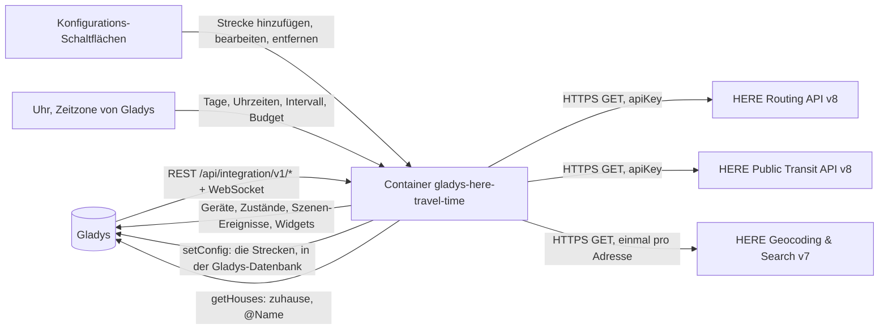
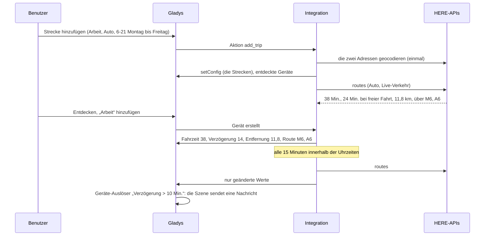
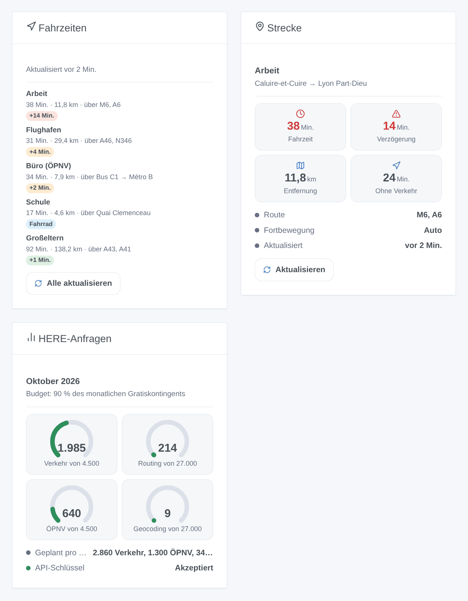

# Gladys HERE Travel Time

[English](README.md) · [Français](README.fr.md) · **Deutsch** · [Español](README.es.md)

[](LICENSE)
[](https://github.com/William-De71/gladys-here-travel-time/releases)
[](https://github.com/William-De71/gladys-here-travel-time/actions/workflows/release.yml)
[](https://gladysassistant.com)


Externe Integration für [Gladys Assistant](https://gladysassistant.com), die Ihre üblichen Strecken mit den Fahrzeiten von HERE verfolgt: Auto, Lkw, Roller / Motorrad, Fahrrad, zu Fuß und ÖPNV, Live-Verkehr, Verkehrsverzögerung, Entfernung, Hauptstraßen oder Linien, Szenen bei Routenänderung und Dashboard-Widgets. Sie nutzt die offiziellen HERE-APIs Routing, Public Transit und Geocoding & Search mit Ihrem eigenen API-Schlüssel und hält ihre Anfragen standardmäßig im kostenlosen Monatskontingent des HERE-Base-Tarifs.

Benutzerdokumentation: [English](docs/en.md) · [Français](docs/fr.md) · [Deutsch](docs/de.md) · [Español](docs/es.md).

Nicht mit HERE verbunden. **Noch nicht mit einem echten HERE-API-Schlüssel getestet**: Die Anfragen folgen den OpenAPI-Spezifikationen, die die HERE-APIs selbst ausliefern, geprüft gegen ihre echten Fehlerantworten.

## Funktionen

- Strecken in **einfachen Formularen** der Konfiguration (kein JSON): Start und Ziel als Adresse (einmal geocodiert, dann gespeichert), „Breite, Länge“, `zuhause` oder `@Name` für ein Haus von Gladys; Auto (mit oder ohne Live-Verkehr), Lkw, Roller / Motorrad, Fahrrad, zu Fuß oder ÖPNV; Maut, Autobahnen und Fähren meiden.
- **Ein Gerät pro Strecke**: Fahrzeit (mit Live-Verkehr per Auto, Lkw und Roller), Fahrzeit ohne Verkehr, Verkehrsverzögerung, Entfernung, Hauptstraßen — oder im ÖPNV Linien und Zeiten („Bus C1 → Métro B · 07:49–08:16“).
- Gemessen **nur an den gewählten Tagen und Uhrzeiten** („6-10, 16-20“, Montag bis Freitag…), alle 5 bis 240 Minuten.
- Ein **Monatsbudget je Anfrageart** (Routing mit Verkehr, Routing, Lkw, Roller, ÖPNV, Geocodierung): standardmäßig 90 % des kostenlosen HERE-Kontingents; die Intervalle werden gestreckt, statt es zu überschreiten.
- **3 Szenen-Auslöser**, **2 Szenen-Aktionen** und **3 Dashboard-Widgets** (unten), mit Link zur Route auf HERE WeGo.
- Vier Sprachen überall: Englisch, Französisch, Deutsch, Spanisch.

## Funktionsweise




Von einer neuen Strecke zur Szene:



### Transport

`transports: ["cloud"]`: Die Strecken berechnet HERE. **Die Koordinaten Ihrer Strecken werden bei jeder Messung mit Ihrem API-Schlüssel an HERE gesendet**, eine Adresse einmalig bei ihrer Geocodierung; sonst verlässt nichts Ihr Gladys. Die Strecken selbst stehen in der Gladys-Konfiguration (und folgen ihren Sicherungen); `/data` enthält die letzten Messungen, den Anfragezähler und die geocodierten Adressen.

## Geräte und Funktionen

| Gerät             | Funktionen (Kategorie / Typ)                                                                                                                                                                                                       |
| ----------------- | ---------------------------------------------------------------------------------------------------------------------------------------------------------------------------------------------------------------------------------- |
| Eines pro Strecke | Fahrzeit (`duration` / `integer`, Minuten), Fahrzeit ohne Verkehr und Verkehrsverzögerung (Strecken mit Live-Verkehr), Entfernung (`distance-sensor` / `decimal`, km), Route: Hauptstraßen oder Linien und Zeiten im ÖPNV (`text`) |

Die externen IDs beruhen auf einer zufälligen Kennung, die jede Strecke beim Hinzufügen erhält und für immer behält, nie auf ihrem Namen oder ihren Adressen: Eine umbenannte Strecke oder ein verlegtes Ziel behält Gerät und Verlauf. Ein Wechsel zwischen einer Art mit Live-Verkehr (Auto, Lkw, Roller) und einer ohne (Auto ohne Verkehr, Fahrrad, zu Fuß, ÖPNV) fügt die Verkehrsfunktionen hinzu oder entfernt sie („Aktualisieren“ im Tab Entdecken).

## Szenen-Auslöser, Aktionen und Widgets



**Widgets**: Fahrzeiten (die Strecken mit Zeit, Entfernung, Straßen oder Linien, ein Badge — die Verzögerung grün, orange ab 3 Minuten, rot ab der Schwelle; im ÖPNV die erste Abfahrt oder die Echtzeit-Verspätung — ein HERE-WeGo-Link und „Alle aktualisieren“), Strecke (eine Strecke: bis zu vier Kacheln, Route, Zeiten, letzte Messung, „Aktualisieren“), HERE-Anfragen (eine Anzeige je Anfrageart, der Monatsplan, der Zustand des Schlüssels). Eine Aktualisieren-Schaltfläche verbraucht eine Anfrage pro Strecke, keine für eine vor weniger als einer Minute gemessene Strecke.

**Auslöser** (ein Ereignis pro Übergang, nie als Folge einer Aktion):

- Die Route einer Strecke ändert sich: Bei einer geplanten Messung führt die schnellste Route über andere Straßen (gesperrte Straße, Unfall) oder andere Linien. Filter: die Strecke. Variablen: Name, Route, vorherige Route, Fahrzeit, Verzögerung, Entfernung, Zusammenfassung.
- Das Monatsbudget ist fast verbraucht: Eine Anfrageart erreicht 80 %, dann 100 %, jeweils einmal im Monat. Filter: Stufe, Anfrageart.
- HERE lehnt den API-Schlüssel ab: einmal, bis eine Anfrage wieder funktioniert. Variablen: Grund, Zusammenfassung (mit Lösung).

Verzögerung, Fahrzeit und Entfernung sind Gerätefunktionen: „die Verzögerung übersteigt 10 Minuten“ ist ein Geräte-Auslöser von Gladys.

**Aktionen**: jetzt eine Route zwischen zwei beliebigen Orten berechnen (Fahrzeit, Fahrzeit ohne Verkehr, Verzögerung, Entfernung, Route, Abfahrts- und Ankunftszeit, Zusammenfassung); eine Strecke jetzt messen, auch außerhalb ihrer Uhrzeiten (gleiche Ausgaben, das Gerät wird aktualisiert).

Beispiele:

- Wenn die Verzögerung von „Arbeit“ an einem Werktagmorgen 10 Minuten übersteigt → die Zusammenfassung senden und den Wecker 15 Minuten vorstellen.
- Wenn sich die Route von „Arbeit“ ändert → „Verkehr umgeleitet: {{triggerEvent.data.summary}}“ melden.
- Um 7:15 → die ÖPNV-Strecke „Büro“ jetzt messen → ihre Zusammenfassung senden: Linien, erste Abfahrt, Umstiege, Echtzeit-Verspätung.

## Voraussetzungen

- Gladys Assistant **5.3.0** oder neuer (Widgets und Szenen der Integrationen, Katalog-Schlüsselwörter von Gladys 5.3): Ältere Instanzen können die Integration nicht installieren.
- Ein **HERE-API-Schlüssel**: ein kostenloses Konto auf [platform.here.com](https://platform.here.com) (Base-Tarif, bei der Anmeldung wird ein Zahlungsmittel verlangt), eine im Access Manager registrierte App, ein im Tab Credentials erstellter API-Schlüssel. Schritt für Schritt in [docs/de.md](docs/de.md#voraussetzungen).
- Die Zeitzone von Gladys richtig eingestellt (Einstellungen > System): Die Uhrzeiten der Strecken gelten in ihr.
- Für `zuhause` / `@Name`: der Standort der Häuser unter Einstellungen > Häuser (die Integration fragt die Berechtigung `location` an).

### Kosten

HERE zählt eine Transaktion pro Anfrage; der Base-Tarif gewährt ein kostenloses Monatskontingent je Anfrageart ([Preise](https://www.here.com/get-started/pricing) abgerufen am 26.10.2026):

| Anfrageart          | Strecken                        | Kostenlos pro Monat | Danach, pro 1.000 |
| ------------------- | ------------------------------- | ------------------- | ----------------- |
| Routing mit Verkehr | Auto mit Live-Verkehr           | 5.000               | 2,92 USD          |
| Routing             | Auto ohne Verkehr, Fahrrad, Fuß | 30.000              | 0,88 USD          |
| Lkw                 | Lkw                             | 5.000               | 2,92 USD          |
| Roller              | Roller / Motorrad               | 5.000               | 2,92 USD          |
| ÖPNV                | öffentliche Verkehrsmittel      | 5.000               | 2,92 USD          |
| Geocodierung        | jede neue Adresse, einmal       | 30.000              | 0,88 USD          |

Eine Autostrecke, die montags bis freitags von 6 bis 21 Uhr alle 15 Minuten gemessen wird, plant etwa 1.300 Anfragen im Monat: drei passen ins Standardbudget (90 % von 5.000), etwa 18 ohne Live-Verkehr. Darüber hinaus werden die Intervalle der Strecken dieser Art gestreckt. Eine Auto-Anfrage ohne Live-Verkehr sendet `departureTime=any`, wie HERE es für den Routing-Tarif verlangt. Das kostenlose Kontingent gilt pro HERE-Konto: Andere Apps zählen mit.

## Installation

- **Aus dem Store**: Integrationen → HERE Travel Time → Installieren.
- **Über die Repository-URL**: Integrationen → externe Integration → `https://github.com/William-De71/gladys-here-travel-time`.
- **Entwicklermodus**: `npm start` mit den von Gladys gelieferten Variablen starten (siehe Entwicklung).

## Konfiguration

| Feld oder Schaltfläche                    | Standard    | Bedeutung                                                                                                    |
| ----------------------------------------- | ----------- | ------------------------------------------------------------------------------------------------------------ |
| HERE-API-Schlüssel                        | —           | Erforderlich, geheim                                                                                         |
| Standardintervall                         | 15 Min.     | 5 bis 240; für Strecken ohne eigenes                                                                         |
| Standard-Verzögerungsschwelle             | 10 Min.     | Rotes Badge in den Widgets ab dieser Verzögerung                                                             |
| Monatsbudget                              | 90 %        | Anteil des kostenlosen Kontingents jeder Anfrageart; über 100 berechnet HERE                                 |
| Sprache der Texte                         | automatisch | Funktionsnamen, Routentexte, Szenen-Zusammenfassungen, Meldungen, bei HERE angefragte Sprache                |
| Strecke hinzufügen / ändern / entfernen   | —           | Ein Formular pro Strecke: Name, Start, Ziel, Art, Live-Verkehr, meiden, Tage, Uhrzeiten, Intervall, Schwelle |
| Strecken auflisten / API-Schlüssel testen | —           | Zeitplan, Plan und letzte Messung jeder Strecke; ein kurzer Fußweg in Paris aus Koordinaten (1 Anfrage)      |

## Verwendung

1. Fügen Sie Ihren API-Schlüssel ein und drücken Sie **API-Schlüssel testen** (Integrationen → HERE Travel Time → Konfiguration).
2. **Strecke hinzufügen** für jede übliche Strecke und die Orte in der Antwort prüfen; die erste Messung kommt innerhalb einer Minute, wenn sie in ihren Uhrzeiten ist.
3. **Entdecken**, dann die gewünschten Strecken als Geräte hinzufügen.
4. Die Widgets einem Dashboard hinzufügen und Szenen mit den Gerätefunktionen, Auslösern und Aktionen bauen.

## Entwicklung

```bash
npm install
npm test                       # node --test, nie Netzwerkzugriff
npm run lint                   # ESLint
npm run format:check           # Prettier
npx github:GladysAssistant/integration-store . --skip-image-check
scripts/build-cover.sh         # cover.jpg aus docs/assets/cover.svg
docs/illustrations/render.sh   # docs/assets/widgets.<lang>.png
```

Lokal liest das SDK `GLADYS_HOST_API_URL`, `GLADYS_INTEGRATION_TOKEN` und `GLADYS_INTEGRATION_SELECTOR` (im Entwicklermodus von Gladys geliefert), die Integration liest `TZ`. `DEBUG=gladys-integration-sdk` zeigt die SDK-Protokolle.

Die Tests decken den HERE-Client ab (Anfragen je Art, Planungsmodus, Meide-Optionen, Abschnitte und Fähren, Routen-Labels und ihr Ersatz, ÖPNV-Linien und -Zeiten, Fehler 401 / 403 / 429 / 400, Hinweise, Abrechnungszählung, der Schlüssel nie in einer Meldung), die Orte (Koordinaten, Häuser, Geocodierungs-Cache), den Zeitplan (Uhrzeiten, Tage, Mitternacht, Monatsplan, Strecken), die Formulare und das Register, die Geräte (die vom Entdecken-Bildschirm verlangten Felder), die Widgets (`validateWidgetContent`), die Szenen-Ereignisse und -Ausgaben, die Uhr (Intervall, Neustart, abgelehnter Schlüssel, 429, Budget), das Manifest, die vier Sprachen, das Release-Skript und die ganze Integration gegen das Fake-Gladys des SDK und ein Fake-fetch. `test/structure.test.js` friert jeden gespeicherten Schlüssel ein.

## Release-Prozess


Jeder Merge auf `main` startet die CI und berechnet dann die Version aus den [Conventional Commits](https://www.conventionalcommits.org/de/) seit dem letzten Tag: `feat` → Minor, `fix` / `perf` → Patch, `!` oder `BREAKING CHANGE` → Major (ein Minor unter 1.0.0); `docs`, `chore`, `ci`, `test`, `style`, `refactor`, `build` allein veröffentlichen nichts. Der Changelog-Abschnitt wird erzeugt, der Tag gepusht, das Multi-Architektur-Image gebaut, dann erhält `main` den Release-Commit, das GitHub Release wird erstellt und ein letzter Job prüft das öffentliche Image, den Store-Validator und das Topic.

- Der Titel des Pull Requests wird zum Squash-Commit und dann zur Changelog-Zeile: auf Englisch, für den Benutzer (`pr-title.yml` prüft ihn). `CHANGELOG.md` nie von Hand ändern.
- 1.0.0 ist eine Entscheidung: Actions → Release → Run workflow mit `release-as: 1.0.0`. `dry-run` zeigt Version und Notizen, ohne zu veröffentlichen.
- **Geschützter Branch**: Das Release pusht seinen Commit mit `GITHUB_TOKEN` auf `main`. Das Ruleset `protect-main` (kein Löschen, kein Force-Push) lässt ihn durch; eine strengere Regel (Pull Request erforderlich, Status-Checks) bräuchte GitHub Actions in der Bypass-Liste oder eine GitHub App.
- Nach dem ersten Release das Paket auf `ghcr.io` öffentlich machen (Package settings → Change visibility), sonst kann Gladys es nicht laden.

## Fehlerbehebung

Siehe [docs/de.md](docs/de.md#fehlerbehebung). Melden Sie Probleme mit den Versionen von Gladys und der Integration, dem Ergebnis von „Strecken auflisten“ (Adressen gern ausblenden) und den Protokollen der Integration. Fügen Sie nie Ihren API-Schlüssel ein.

## Mitwirken

Issues und Pull Requests sind willkommen. Führen Sie `npm run format:check && npm run lint && npm test` vor einem Pull Request aus und lassen Sie alle externen IDs und gespeicherten Schlüssel unverändert (siehe [CLAUDE.md](CLAUDE.md)).

## Sicherheit

Siehe [SECURITY.md](SECURITY.md): Schwachstellen bitte vertraulich melden. Der API-Schlüssel ist ein `secret`-Feld: nie protokolliert, nie in `/data` geschrieben, nur per HTTPS an die `hereapi.com`-APIs gesendet (im URL-Parameter `apiKey`, der einzigen Schlüssel-Authentifizierung dieser APIs: Die URLs werden nie protokolliert und jede Fehlermeldung wird vom Schlüssel bereinigt).

## Kommende Screenshots

Die Bilder oben sind Illustrationen, keine Screenshots. Echte Screenshots kommen nach `docs/assets/screenshots/` (PNG, 1280 × 800): `configuration.png` (das Formular „Strecke hinzufügen“), `discovery.png`, `device.png`, `scene.png`.

## Lizenz

[Apache License 2.0](LICENSE) — siehe auch [NOTICE](NOTICE). HERE ist eine Marke der HERE Global B.V. Dank an die Dokumentation und das SDK von Gladys sowie an die Home-Assistant-Integration HERE Travel Time für ihre Ergonomie.
