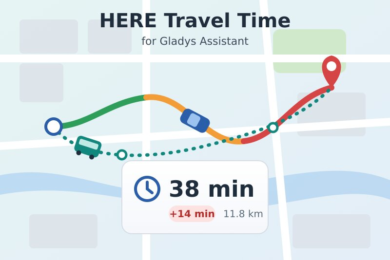
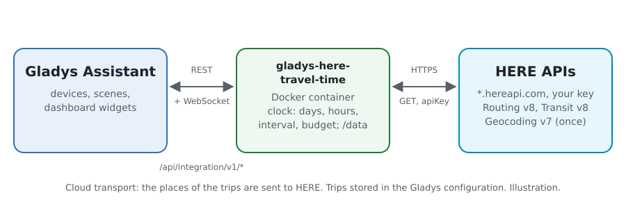
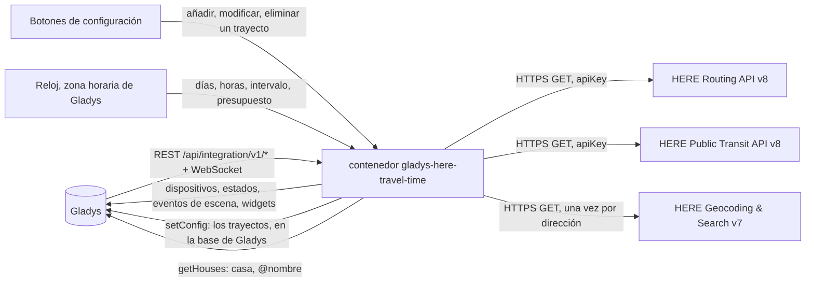
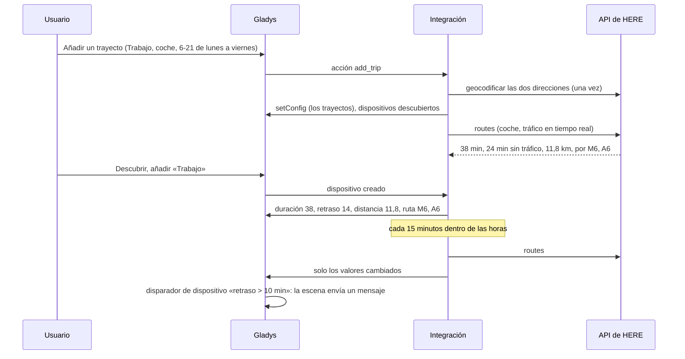
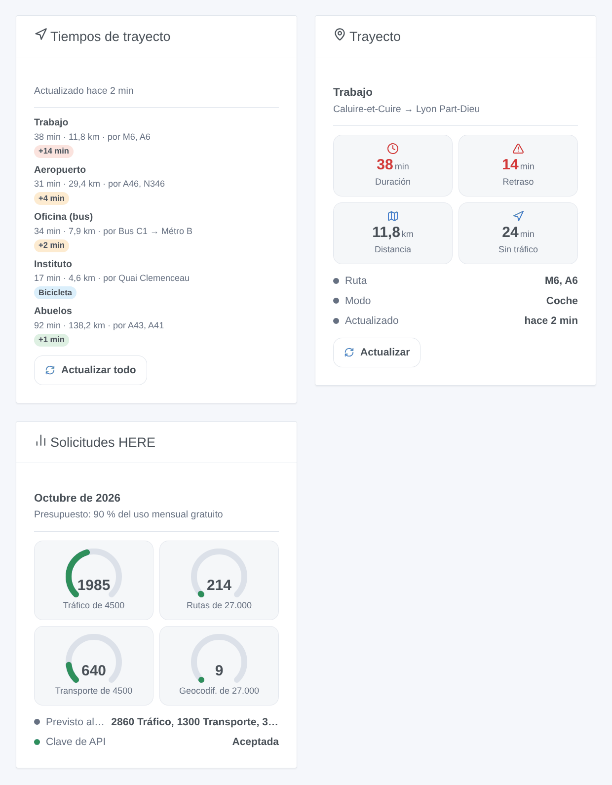

# Gladys HERE Travel Time

[English](README.md) · [Français](README.fr.md) · [Deutsch](README.de.md) · **Español**

[](LICENSE)
[](https://github.com/William-De71/gladys-here-travel-time/releases)
[](https://github.com/William-De71/gladys-here-travel-time/actions/workflows/release.yml)
[](https://gladysassistant.com)



Integración externa de [Gladys Assistant](https://gladysassistant.com) que sigue sus trayectos habituales con los tiempos de trayecto de HERE: coche, camión, scooter / moto, bicicleta, a pie y transporte público, tráfico en tiempo real, retraso por tráfico, distancia, carreteras principales o líneas, escenas cuando cambia la ruta y widgets de panel. Usa las API oficiales HERE Routing, Public Transit y Geocoding & Search con su propia clave de API, y por defecto mantiene sus solicitudes dentro del uso mensual gratuito del plan Base de HERE.

Documentación de usuario: [English](docs/en.md) · [Français](docs/fr.md) · [Deutsch](docs/de.md) · [Español](docs/es.md).

Sin relación con HERE. **Todavía no probada con una clave de API de HERE real**: las solicitudes siguen las especificaciones OpenAPI que sirven las propias API de HERE, comprobadas con sus respuestas de error reales.

## Funciones

- Trayectos en **formularios sencillos** de la configuración (sin JSON): origen y destino como dirección (geocodificada una vez y guardada), «latitud, longitud», `casa` o `@nombre` para una casa de Gladys; coche (con o sin tráfico en tiempo real), camión, scooter / moto, bicicleta, a pie o transporte público; evitar peajes, autopistas y ferris.
- **Un dispositivo por trayecto**: duración (con tráfico en coche, camión y scooter), duración sin tráfico, retraso por tráfico, distancia, carreteras principales — o, en transporte público, las líneas y horarios («Bus C1 → Métro B · 07:49–08:16»).
- Medido **solo en los días y horas elegidos** («6-10, 16-20», de lunes a viernes…), cada 5 a 240 minutos.
- Un **presupuesto mensual por tipo de solicitud** (rutas con tráfico, rutas, camión, scooter, transporte público, geocodificación): 90 % del uso gratuito de HERE por defecto; los intervalos se alargan antes que superarlo.
- **3 disparadores de escena**, **2 acciones de escena** y **3 widgets** (abajo), con un enlace a la ruta en HERE WeGo.
- Cuatro idiomas en todo: inglés, francés, alemán, español.

## Funcionamiento





De un trayecto nuevo a una escena:



### Transporte

`transports: ["cloud"]`: HERE calcula los trayectos. **Las coordenadas de sus trayectos se envían a HERE** con su clave de API en cada medida, y una dirección una vez al geocodificarla; nada más sale de su Gladys. Los trayectos se guardan en la configuración de Gladys (y siguen sus copias de seguridad); `/data` guarda las últimas medidas, el contador de solicitudes y las direcciones geocodificadas.

## Dispositivos y funciones

| Dispositivo      | Funciones (categoría / tipo)                                                                                                                                                                                                                    |
| ---------------- | ----------------------------------------------------------------------------------------------------------------------------------------------------------------------------------------------------------------------------------------------- |
| Uno por trayecto | Duración (`duration` / `integer`, minutos), duración sin tráfico y retraso por tráfico (trayectos con tráfico), distancia (`distance-sensor` / `decimal`, km), ruta: carreteras principales, o líneas y horarios en transporte público (`text`) |

Los identificadores externos se basan en un identificador aleatorio que recibe cada trayecto al añadirlo y conserva para siempre, nunca en su nombre ni en sus direcciones: renombrar un trayecto o mover su destino conserva su dispositivo y su historial. Pasar de un modo con tráfico (coche, camión, scooter) a uno sin él (coche sin tráfico, bicicleta, a pie, transporte público) añade o quita las funciones de tráfico («Actualizar» en la pestaña Descubrir).

## Disparadores, acciones de escena y widgets



**Widgets**: Tiempos de trayecto (los trayectos con duración, distancia, carreteras o líneas, una insignia — el retraso en verde, naranja desde 3 minutos, rojo desde el umbral; la primera salida o el retraso en tiempo real en transporte público — un enlace a HERE WeGo y un botón «Actualizar todo»), Trayecto (un trayecto: hasta cuatro mosaicos, ruta, horarios, última medida, «Actualizar»), Solicitudes HERE (un indicador por tipo de solicitud, el plan del mes, el estado de la clave). Un botón de actualización gasta una solicitud por trayecto, ninguna para un trayecto medido hace menos de un minuto.

**Disparadores** (un evento por transición, nunca como resultado de una acción):

- La ruta de un trayecto cambia: en una medida programada, la ruta más rápida pasa por otras carreteras (carretera cortada, accidente) u otras líneas. Filtro: el trayecto. Variables: nombre, ruta, ruta anterior, duración, retraso, distancia, resumen.
- El presupuesto mensual está casi gastado: un tipo de solicitud alcanza el 80 % y luego el 100 %, una vez cada uno al mes. Filtros: nivel, tipo de solicitud.
- HERE rechaza la clave de API: una vez, hasta que una solicitud vuelva a funcionar. Variables: motivo, resumen (con qué corregir).

El retraso, la duración y la distancia son funciones del dispositivo: «el retraso supera 10 minutos» es un disparador de dispositivo de Gladys.

**Acciones**: calcular ahora una ruta entre dos lugares cualesquiera (duración, duración sin tráfico, retraso, distancia, ruta, horas de salida y llegada, frase de resumen); medir un trayecto ahora, también fuera de sus horas (mismas salidas, el dispositivo se actualiza).

Ejemplos:

- Cuando el retraso de «Trabajo» supera 10 minutos una mañana laborable → enviar el resumen y adelantar el despertador 15 minutos.
- Cuando cambia la ruta de «Trabajo» → notificar «Tráfico desviado: {{triggerEvent.data.summary}}».
- A las 7:15 → medir ahora el trayecto en transporte público «Oficina» → enviar su resumen: líneas, primera salida, transbordos, retraso en tiempo real.

## Requisitos

- Gladys Assistant **5.3.0** o posterior (widgets y escenas de las integraciones, palabras clave del catálogo de Gladys 5.3): las instancias anteriores no pueden instalar la integración.
- Una **clave de API de HERE**: una cuenta gratuita en [platform.here.com](https://platform.here.com) (plan Base, se pide un método de pago al registrarse), una aplicación registrada en el Access Manager, una clave de API creada en su pestaña Credentials. Paso a paso en [docs/es.md](docs/es.md#requisitos-previos).
- La zona horaria de Gladys bien configurada (Ajustes > Sistema): las horas de los trayectos se leen en ella.
- Para `casa` / `@nombre`: la ubicación de las casas en Ajustes > Casas (la integración pide el permiso `location`).

### Coste

HERE cuenta una transacción por solicitud; el plan Base da un uso mensual gratuito por tipo de solicitud ([precios](https://www.here.com/get-started/pricing) consultados el 26/10/2026):

| Tipo de solicitud  | Trayectos                           | Gratis al mes | Después, por 1000 |
| ------------------ | ----------------------------------- | ------------- | ----------------- |
| Rutas con tráfico  | coche con tráfico en tiempo real    | 5000          | 2,92 USD          |
| Rutas              | coche sin tráfico, bicicleta, a pie | 30 000        | 0,88 USD          |
| Camión             | camión                              | 5000          | 2,92 USD          |
| Scooter            | scooter / moto                      | 5000          | 2,92 USD          |
| Transporte público | transporte público                  | 5000          | 2,92 USD          |
| Geocodificación    | cada dirección nueva, una vez       | 30 000        | 0,88 USD          |

Un trayecto en coche medido cada 15 minutos de 6 a 21, de lunes a viernes, prevé unas 1300 solicitudes al mes: tres caben en el presupuesto por defecto (90 % de 5000), unos 18 sin tráfico. Más allá, se alargan los intervalos de los trayectos de ese tipo. Una solicitud de coche sin tráfico envía `departureTime=any`, como exige HERE para la tarifa Rutas. El uso gratuito es por cuenta HERE: las otras aplicaciones también cuentan.

## Instalación

- **Desde la tienda**: Integraciones → HERE Travel Time → Instalar.
- **Desde la URL del repositorio**: Integraciones → integración externa → `https://github.com/William-De71/gladys-here-travel-time`.
- **Modo desarrollador**: ejecute `npm start` con las variables que da Gladys (ver Desarrollo).

## Configuración

| Campo o botón                                 | Por defecto | Significado                                                                                                   |
| --------------------------------------------- | ----------- | ------------------------------------------------------------------------------------------------------------- |
| Clave de API de HERE                          | —           | Obligatoria, un secreto                                                                                       |
| Intervalo por defecto                         | 15 min      | 5 a 240; para los trayectos sin intervalo propio                                                              |
| Umbral de retraso por defecto                 | 10 min      | Insignia roja en los widgets desde este retraso                                                               |
| Presupuesto mensual                           | 90 %        | Parte del uso gratuito de cada tipo de solicitud; por encima de 100, HERE factura                             |
| Idioma de los textos                          | automático  | Nombres de funciones, textos de ruta, resúmenes de escenas, mensajes, idioma pedido a HERE                    |
| Añadir / Modificar / Eliminar un trayecto     | —           | Un formulario por trayecto: nombre, origen, destino, modo, tráfico, evitar, días, horas, intervalo, umbral    |
| Listar los trayectos / Probar la clave de API | —           | Horario, plan y última medida de cada trayecto; un breve paseo en París a partir de coordenadas (1 solicitud) |

## Uso

1. Pegue su clave de API y pulse **Probar la clave de API** (Integraciones → HERE Travel Time → Configuración).
2. **Añada un trayecto** por cada trayecto habitual y compruebe los lugares en la respuesta; su primera medida llega en un minuto si está en sus horas.
3. **Descubrir**, y luego añada los trayectos que quiera como dispositivos.
4. Añada los widgets a un panel y cree escenas con las funciones de los dispositivos, los disparadores y las acciones.

## Desarrollo

```bash
npm install
npm test                       # node --test, nunca toca la red
npm run lint                   # ESLint
npm run format:check           # Prettier
npx github:GladysAssistant/integration-store . --skip-image-check
scripts/build-cover.sh         # cover.jpg desde docs/assets/cover.svg
docs/illustrations/render.sh   # docs/assets/widgets.<lang>.png
```

En local, el SDK lee `GLADYS_HOST_API_URL`, `GLADYS_INTEGRATION_TOKEN` y `GLADYS_INTEGRATION_SELECTOR` (que Gladys da en modo desarrollador), y la integración lee `TZ`. `DEBUG=gladys-integration-sdk` muestra los registros del SDK.

Las pruebas cubren el cliente de HERE (solicitudes por modo, modo planificación, opciones de evitar, secciones y ferris, etiquetas de ruta y su alternativa, líneas y horarios del transporte público, errores 401 / 403 / 429 / 400, avisos, recuento facturado, la clave nunca en un mensaje), los lugares (coordenadas, casas, caché de geocodificación), el horario (horas, días, medianoche, plan mensual, alargamiento), los formularios y el registro, los dispositivos (los campos que exige la pantalla Descubrir), los widgets (`validateWidgetContent`), los eventos y salidas de escena, el reloj (intervalo, reinicio, clave rechazada, 429, presupuesto), el manifiesto, los cuatro idiomas, el script de release y toda la integración frente al Gladys falso del SDK y un fetch falso. `test/structure.test.js` congela cada clave guardada por los usuarios.

## Proceso de release


Cada fusión en `main` ejecuta la CI y luego calcula la versión a partir de los [Conventional Commits](https://www.conventionalcommits.org/es/) desde la última etiqueta: `feat` → menor, `fix` / `perf` → parche, `!` o `BREAKING CHANGE` → mayor (una menor por debajo de 1.0.0); `docs`, `chore`, `ci`, `test`, `style`, `refactor`, `build` solos no publican nada. Se genera la sección del changelog, se sube la etiqueta, se construye la imagen multiarquitectura, luego `main` recibe el commit de release, se crea la GitHub Release y un último job comprueba la imagen pública, el validador de la tienda y el topic.

- El título de la pull request se convierte en el commit squash y luego en la línea del changelog: escríbalo en inglés, para el usuario (`pr-title.yml` lo comprueba). Nunca edite `CHANGELOG.md` a mano.
- 1.0.0 es una decisión: Actions → Release → Run workflow con `release-as: 1.0.0`. `dry-run` muestra la versión y las notas sin publicar.
- **Rama protegida**: la release sube su commit a `main` con `GITHUB_TOKEN`. El ruleset `protect-main` (sin borrado, sin force-push) lo deja pasar; una regla más estricta (pull request obligatoria, status checks) necesitaría GitHub Actions en su lista de excepciones, o una GitHub App.
- Tras la primera release, haga público el paquete de `ghcr.io` (Package settings → Change visibility), o Gladys no podrá descargarlo.

## Solución de problemas

Vea [docs/es.md](docs/es.md#solución-de-problemas). Informe de los problemas con las versiones de Gladys y de la integración, el resultado de «Listar los trayectos» (oculte sus direcciones si quiere) y los registros de la integración. Nunca pegue su clave de API.

## Contribuir

Issues y pull requests son bienvenidas. Ejecute `npm run format:check && npm run lint && npm test` antes de abrir una pull request, y mantenga sin cambios todos los identificadores externos y claves guardadas (vea [CLAUDE.md](CLAUDE.md)).

## Seguridad

Vea [SECURITY.md](SECURITY.md): informe de las vulnerabilidades en privado. La clave de API es un campo `secret`: nunca se registra, nunca se escribe en `/data`, solo se envía a las API de `hereapi.com` por HTTPS (en el parámetro `apiKey` de la URL, única autenticación por clave de estas API: las URL nunca se registran y cada mensaje de error se limpia de la clave).

## Capturas por venir

Las imágenes de arriba son ilustraciones, no capturas de pantalla. Las capturas reales irán en `docs/assets/screenshots/` (PNG, 1280 × 800): `configuration.png` (el formulario «Añadir un trayecto»), `discovery.png`, `device.png`, `scene.png`.

## Licencia

[Apache License 2.0](LICENSE) — vea también [NOTICE](NOTICE). HERE es una marca de HERE Global B.V. Gracias a la documentación y al SDK de Gladys, y a la integración HERE Travel Time de Home Assistant por su ergonomía.
