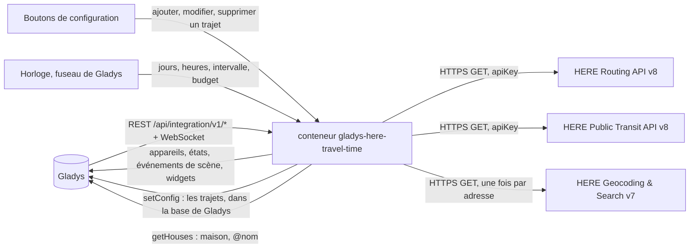
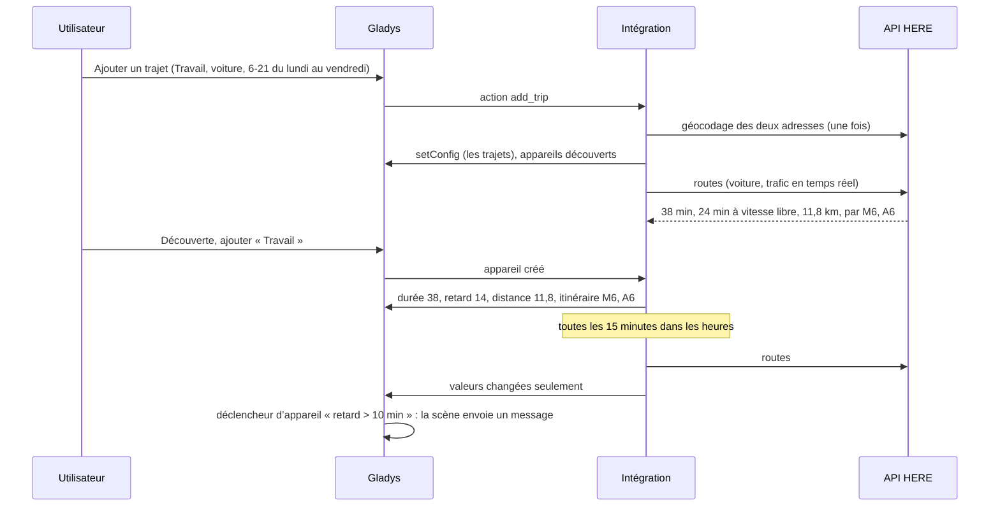
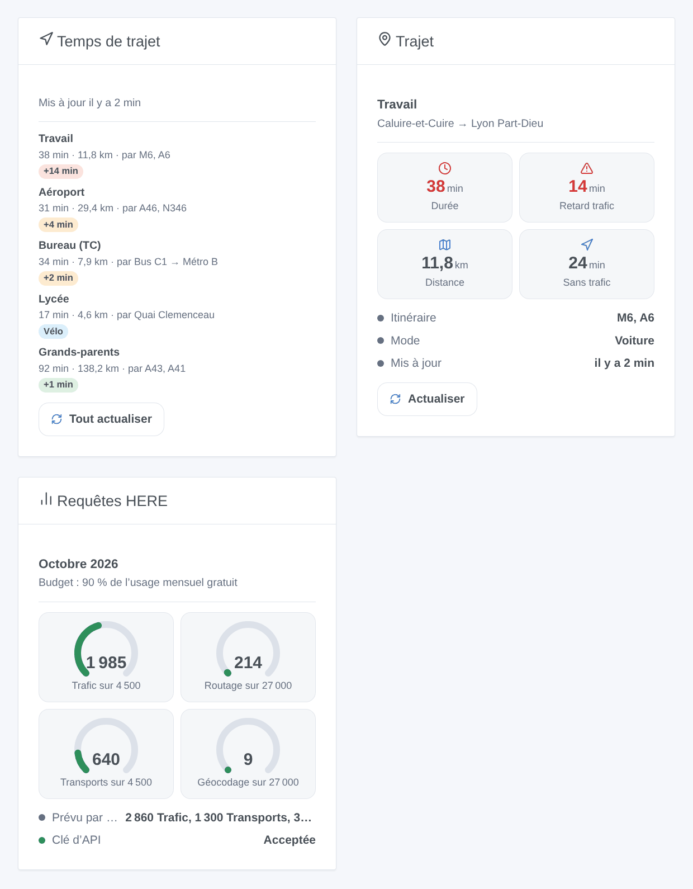

# Gladys HERE Travel Time

[English](README.md) · **Français** · [Deutsch](README.de.md) · [Español](README.es.md)

[](LICENSE)
[](https://github.com/William-De71/gladys-here-travel-time/releases)
[](https://github.com/William-De71/gladys-here-travel-time/actions/workflows/release.yml)
[](https://gladysassistant.com)


Intégration externe de [Gladys Assistant](https://gladysassistant.com) qui suit vos trajets habituels avec les temps de trajet de HERE : voiture, camion, scooter / moto, vélo, marche et transports en commun, trafic en temps réel, retard dû au trafic, distance, routes principales ou lignes, scènes quand l’itinéraire change, et widgets de tableau de bord. Elle utilise les API officielles HERE Routing, Public Transit et Geocoding & Search avec votre propre clé d’API, et garde par défaut ses requêtes dans l’usage mensuel gratuit du plan Base de HERE.

Documentation utilisateur : [English](docs/en.md) · [Français](docs/fr.md) · [Deutsch](docs/de.md) · [Español](docs/es.md).

Sans lien avec HERE. **Pas encore testée avec une vraie clé d’API HERE** : les requêtes suivent les spécifications OpenAPI servies par les API HERE, vérifiées contre leurs vraies réponses d’erreur.

## Fonctionnalités

- Trajets saisis dans de **simples formulaires** de la configuration (pas de JSON) : départ et arrivée en adresse (géocodée une fois, puis gardée), « latitude, longitude », `maison` ou `@nom` pour une maison de Gladys ; voiture (avec ou sans trafic en temps réel), camion, scooter / moto, vélo, marche ou transports en commun ; éviter péages, autoroutes et ferries.
- **Un appareil par trajet** : durée (avec trafic en voiture, camion et scooter), durée sans trafic, retard dû au trafic, distance, routes principales — ou, en transports en commun, les lignes et horaires (« Bus C1 → Métro B · 07:49–08:16 »).
- Mesuré **uniquement sur les jours et heures choisis** (« 6-10, 16-20 », du lundi au vendredi…), toutes les 5 à 240 minutes.
- Un **budget mensuel par type de requête** (routage avec trafic, routage, camion, scooter, transports en commun, géocodage) : 90 % de l’usage gratuit de HERE par défaut ; les intervalles sont allongés plutôt que de le dépasser.
- **3 déclencheurs de scène**, **2 actions de scène** et **3 widgets** (ci-dessous), avec un lien vers l’itinéraire sur HERE WeGo.
- Quatre langues partout : anglais, français, allemand, espagnol.

## Fonctionnement




D’un nouveau trajet à une scène :



### Transport

`transports: ["cloud"]` : les trajets sont calculés par HERE. **Les coordonnées de vos trajets sont envoyées à HERE** avec votre clé d’API à chaque mesure, et une adresse une fois lors de son géocodage ; rien d’autre ne quitte votre Gladys. Les trajets eux-mêmes sont stockés dans la configuration de Gladys (et suivent ses sauvegardes) ; `/data` garde les dernières mesures, le compteur de requêtes et les adresses géocodées.

## Appareils et fonctionnalités

| Appareil      | Fonctionnalités (catégorie / type)                                                                                                                                                                                                             |
| ------------- | ---------------------------------------------------------------------------------------------------------------------------------------------------------------------------------------------------------------------------------------------- |
| Un par trajet | Durée (`duration` / `integer`, minutes), durée sans trafic et retard dû au trafic (trajets avec trafic), distance (`distance-sensor` / `decimal`, km), itinéraire : routes principales, ou lignes et horaires en transports en commun (`text`) |

Les identifiants externes reposent sur un identifiant aléatoire donné à chaque trajet à son ajout et gardé pour toujours, jamais sur son nom ni ses adresses : renommer un trajet ou déplacer sa destination garde son appareil et son historique. Passer d’un mode avec trafic (voiture, camion, scooter) à un mode sans (voiture sans trafic, vélo, marche, transports en commun) ajoute ou retire les fonctionnalités de trafic (« Mettre à jour » dans l’onglet Découverte).

## Déclencheurs, actions de scène et widgets



**Widgets** : Temps de trajet (les trajets avec durée, distance, routes ou lignes, un badge — le retard en vert, orange dès 3 minutes, rouge à partir du seuil ; le premier départ ou le retard en temps réel en transports en commun — un lien HERE WeGo et un bouton « Tout actualiser »), Trajet (un trajet : jusqu’à quatre tuiles, itinéraire, horaires, dernière mesure, « Actualiser »), Requêtes HERE (une jauge par type de requête, le plan du mois, l’état de la clé). Un bouton d’actualisation dépense une requête par trajet, aucune pour un trajet mesuré il y a moins d’une minute.

**Déclencheurs** (un événement par transition, jamais à la suite d’une action) :

- L’itinéraire d’un trajet change : à une mesure planifiée, l’itinéraire le plus rapide passe par d’autres routes (route fermée, accident) ou d’autres lignes. Filtre : le trajet. Variables : nom, itinéraire, itinéraire précédent, durée, retard, distance, résumé.
- Le budget du mois est presque utilisé : un type de requête atteint 80 %, puis 100 %, une fois chacun par mois. Filtres : niveau, type de requête.
- HERE refuse la clé d’API : une fois, jusqu’à ce qu’une requête fonctionne de nouveau. Variables : raison, résumé (avec quoi corriger).

Le retard, la durée et la distance sont des fonctionnalités d’appareil : « le retard dépasse 10 minutes » est un déclencheur d’appareil de Gladys.

**Actions** : calculer maintenant un trajet entre deux lieux quelconques (durée, durée sans trafic, retard, distance, itinéraire, heures de départ et d’arrivée, phrase de résumé) ; mesurer un trajet maintenant, même hors de ses heures (mêmes sorties, l’appareil est mis à jour).

Exemples :

- Quand le retard de « Travail » dépasse 10 minutes un matin de semaine → envoyer le résumé et avancer le réveil de 15 minutes.
- Quand l’itinéraire de « Travail » change → notifier « Trafic dévié : {{triggerEvent.data.summary}} ».
- À 7 h 15 → mesurer maintenant le trajet en transports en commun « Bureau » → envoyer son résumé : lignes, premier départ, correspondances, retard en temps réel.

## Prérequis

- Gladys Assistant **5.3.0** ou plus récent (widgets et scènes des intégrations, mots-clés du catalogue de Gladys 5.3) : les instances plus anciennes ne peuvent pas installer l’intégration.
- Une **clé d’API HERE** : un compte gratuit sur [platform.here.com](https://platform.here.com) (plan Base, un moyen de paiement est demandé à l’inscription), une application enregistrée dans l’Access Manager, une clé d’API créée dans son onglet Credentials. Pas à pas dans [docs/fr.md](docs/fr.md#prérequis).
- Le fuseau horaire de Gladys bien réglé (Paramètres > Système) : les heures des trajets sont lues dans ce fuseau.
- Pour `maison` / `@nom` : l’emplacement des maisons dans Paramètres > Maisons (l’intégration demande l’autorisation `location`).

### Coût

HERE compte une transaction par requête ; le plan Base offre un usage mensuel gratuit par type de requête ([tarifs](https://www.here.com/get-started/pricing) relevés le 26/10/2026) :

| Type de requête      | Trajets                           | Gratuit par mois | Ensuite, les 1 000 |
| -------------------- | --------------------------------- | ---------------- | ------------------ |
| Routage avec trafic  | voiture avec trafic en temps réel | 5 000            | 2,92 USD           |
| Routage              | voiture sans trafic, vélo, marche | 30 000           | 0,88 USD           |
| Camion               | camion                            | 5 000            | 2,92 USD           |
| Scooter              | scooter / moto                    | 5 000            | 2,92 USD           |
| Transports en commun | transports en commun              | 5 000            | 2,92 USD           |
| Géocodage            | chaque nouvelle adresse, une fois | 30 000           | 0,88 USD           |

Un trajet en voiture mesuré toutes les 15 minutes de 6 h à 21 h, du lundi au vendredi, prévoit environ 1 300 requêtes par mois : trois tiennent dans le budget par défaut (90 % de 5 000), environ 18 sans trafic. Au-delà, les intervalles des trajets de ce type sont allongés. Une requête voiture sans trafic envoie `departureTime=any`, comme HERE l’exige pour le tarif Routage. L’usage gratuit est par compte HERE : les autres applications comptent aussi.

## Installation

- **Depuis le store** : Intégrations → HERE Travel Time → Installer.
- **Depuis l’URL du dépôt** : Intégrations → intégration externe → `https://github.com/William-De71/gladys-here-travel-time`.
- **Mode développeur** : lancez `npm start` avec les variables données par Gladys (voir Développement).

## Configuration

| Champ ou bouton                          | Défaut      | Signification                                                                                                         |
| ---------------------------------------- | ----------- | --------------------------------------------------------------------------------------------------------------------- |
| Clé d’API HERE                           | —           | Obligatoire, un secret                                                                                                |
| Intervalle par défaut                    | 15 min      | 5 à 240 ; pour les trajets sans intervalle propre                                                                     |
| Seuil de retard par défaut               | 10 min      | Badge rouge dans les widgets à partir de ce retard                                                                    |
| Budget mensuel                           | 90 %        | Part de l’usage gratuit de chaque type de requête ; au-delà de 100, HERE facture                                      |
| Langue des textes                        | automatique | Noms des fonctionnalités, textes d’itinéraire, résumés des scènes, messages des boutons, langue demandée à HERE       |
| Ajouter / Modifier / Supprimer un trajet | —           | Un formulaire par trajet : nom, départ, arrivée, mode, trafic, éviter, jours, heures, intervalle, seuil               |
| Lister les trajets / Tester la clé d’API | —           | Horaires, plan et dernière mesure de chaque trajet ; une courte marche dans Paris à partir de coordonnées (1 requête) |

## Utilisation

1. Collez votre clé d’API, puis appuyez sur **Tester la clé d’API** (Intégrations → HERE Travel Time → Configuration).
2. **Ajoutez un trajet** pour chaque trajet habituel et vérifiez les lieux dans la réponse ; sa première mesure arrive dans la minute s’il est dans ses heures.
3. **Découverte**, puis ajoutez les trajets voulus comme appareils.
4. Ajoutez les widgets à un tableau de bord, et créez des scènes avec les fonctionnalités des appareils, les déclencheurs et les actions.

## Développement

```bash
npm install
npm test                       # node --test, ne touche jamais le réseau
npm run lint                   # ESLint
npm run format:check           # Prettier
npx github:GladysAssistant/integration-store . --skip-image-check
scripts/build-cover.sh         # cover.jpg depuis docs/assets/cover.svg
docs/illustrations/render.sh   # docs/assets/widgets.<lang>.png
```

En local, le SDK lit `GLADYS_HOST_API_URL`, `GLADYS_INTEGRATION_TOKEN` et `GLADYS_INTEGRATION_SELECTOR` (donnés par Gladys en mode développeur), et l’intégration lit `TZ`. `DEBUG=gladys-integration-sdk` affiche les journaux du SDK.

Les tests couvrent le client HERE (requêtes par mode, mode planification, options d’évitement, sections et ferries, libellés de route et leur repli, lignes et horaires des transports en commun, erreurs 401 / 403 / 429 / 400, notices, décompte facturé, la clé jamais dans un message), les lieux (coordonnées, maisons, cache de géocodage), les horaires (heures, jours, minuit, plan mensuel, allongement), les formulaires et le registre, les appareils (les champs qu’exige l’écran Découverte), les widgets (`validateWidgetContent`), les événements et sorties de scène, l’horloge (intervalle, redémarrage, clé refusée, 429, budget), le manifeste, les quatre langues, le script de release, et toute l’intégration face au faux Gladys du SDK et à un faux fetch. `test/structure.test.js` fige chaque clé stockée chez les utilisateurs.

## Processus de release


Chaque fusion sur `main` lance la CI, puis calcule la version d’après les [Conventional Commits](https://www.conventionalcommits.org/fr/) depuis le dernier tag : `feat` → mineure, `fix` / `perf` → correctif, `!` ou `BREAKING CHANGE` → majeure (une mineure sous 1.0.0) ; `docs`, `chore`, `ci`, `test`, `style`, `refactor`, `build` seuls ne publient rien. La section du changelog est générée, le tag poussé, l’image multi-architecture construite, puis `main` reçoit le commit de release, la GitHub Release est créée et un dernier job vérifie l’image publique, le validateur du store et le topic.

- Le titre de la pull request devient le commit squash, puis la ligne du changelog : écrivez-le en anglais, pour l’utilisateur (`pr-title.yml` le vérifie). Ne modifiez jamais `CHANGELOG.md` à la main.
- 1.0.0 est une décision : Actions → Release → Run workflow avec `release-as: 1.0.0`. `dry-run` montre la version et les notes sans rien publier.
- **Branche protégée** : la release pousse son commit sur `main` avec `GITHUB_TOKEN`. Le ruleset `protect-main` (ni suppression, ni force-push) le laisse passer ; une règle plus stricte (pull request obligatoire, status checks) demanderait GitHub Actions dans sa liste de contournement, ou une GitHub App.
- Après la première release, rendez public le package `ghcr.io` (Package settings → Change visibility), sinon Gladys ne peut pas le télécharger.

## Dépannage

Voir [docs/fr.md](docs/fr.md#dépannage). Signalez les problèmes avec les versions de Gladys et de l’intégration, le résultat de « Lister les trajets » (masquez vos adresses si vous voulez) et les journaux de l’intégration. Ne collez jamais votre clé d’API.

## Contribuer

Issues et pull requests bienvenues. Lancez `npm run format:check && npm run lint && npm test` avant d’ouvrir une pull request, et gardez inchangés tous les identifiants externes et clés stockées (voir [CLAUDE.md](CLAUDE.md)).

## Sécurité

Voir [SECURITY.md](SECURITY.md) : signalez les failles en privé. La clé d’API est un champ `secret` : jamais journalisée, jamais écrite dans `/data`, envoyée uniquement aux API `hereapi.com` en HTTPS (dans le paramètre `apiKey` de l’URL, seule authentification par clé de ces API : les URL ne sont jamais journalisées et chaque message d’erreur est nettoyé de la clé).

## Captures à venir

Les images ci-dessus sont des illustrations, pas des captures d’écran. Les vraies captures iront dans `docs/assets/screenshots/` (PNG, 1280 × 800) : `configuration.png` (le formulaire « Ajouter un trajet »), `discovery.png`, `device.png`, `scene.png`.

## Licence

[Apache License 2.0](LICENSE) — voir aussi [NOTICE](NOTICE). HERE est une marque de HERE Global B.V. Merci à la documentation et au SDK de Gladys, et à l’intégration HERE Travel Time de Home Assistant pour son ergonomie.
